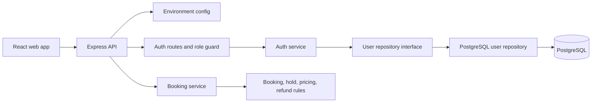

# Architecture

## Current structure

The API exposes `/health`, account registration/login/profile routes, organizer venue/event routes, public published-event browsing, customer booking/payment routes, and notifications. `server.ts` wires the PostgreSQL pool, repositories, and services. `db:migrate` applies SQL files once and records them in `schema_migrations`. The browser includes the account experience, discovery shell, seat picker, booking flow, and organizer studio.

## Layers to complete

1. **HTTP**: auth routes, Zod input validation, bearer authentication, role checks, and consistent errors are present. Venue/event, booking, payment, browse, and notification routes are present.
2. **Application**: auth, event, booking, payment, and notification services are present. Event creation validates organizer-owned venues and generates seat maps transactionally.
3. **Domain**: booking status transitions, hold expiry, pricing, and refund policy.
4. **Persistence**: user, event, booking, payment, notification repositories, and migration runner are present.
5. **Integrations**: mock Stripe and PayPal providers share one payment interface; in-app and console email notification channels share a notification interface.

## Design choices already in code

- **State machine**: `booking.ts` defines permitted transitions in one table. It prevents an invalid lifecycle change before persistence updates the booking and status history.
- **Strategy**: `pricing.ts` maps an event's `base` or `early_bird` choice to a pricing function. A caller selects a strategy without embedding pricing branches in booking code.
- **Dependency boundary**: the Express app is created from explicit configuration, so tests and deployment can provide different settings without changing domain code.
- **Repository interface**: `AuthService` depends on `UserRepository`, and `EventService` depends on `EventRepository`; PostgreSQL is an adapter. Tests use in-memory implementations.
- **Authentication boundary**: the role guard verifies an HMAC-signed, 12-hour bearer token. Passwords use salted scrypt hashes. Event routes must combine role checks with organizer ownership checks against the database.

Payment providers and notification channels use interfaces so additional providers or channels can be added without changing booking code.

## Seat concurrency plan

`event_seats.current_booking_id` represents the current claim. To hold a seat, create a booking and conditionally update the requested seat rows in **one PostgreSQL transaction**, in a stable seat ID order. The update must match only unclaimed seats or expired holds. Check that every requested row was updated before committing; otherwise roll back the whole transaction. PostgreSQL row locking serializes competing updates to the same seat. Payment confirmation is performed only after a successful provider call, and the payment transaction verifies the booking claim before setting `confirmed_at`. Expired holds are released by the scheduled cleanup job and may also be replaced atomically by a new hold. The CI suite runs a two-customer same-seat race against PostgreSQL.

The booking service will validate organizer ownership for event changes, persist every status change in `booking_status_history`, and use `payment_attempts`' unique `(booking_id, idempotency_key)` constraint to make retries safe.
