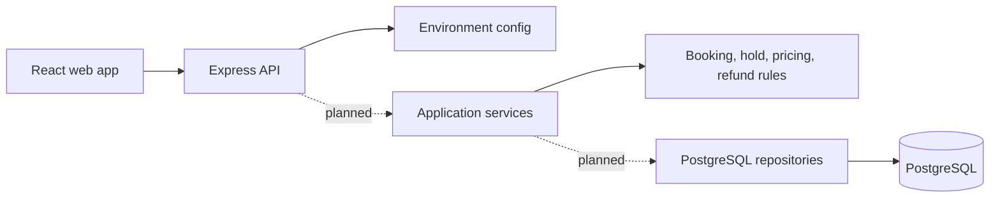

# Architecture

## Current structure

The current API exposes only `/health`. The browser currently displays the event discovery shell. The domain module contains pure functions that can be called by application services once persistence and routes exist. The SQL migration defines the initial relational model; it is not yet connected to the API.

## Layers to complete

1. **HTTP**: authentication, validation, route handlers, and consistent errors.
2. **Application**: booking workflows and authorization checks; transactions live here.
3. **Domain**: booking status transitions, hold expiry, pricing, and refund policy.
4. **Persistence**: PostgreSQL repositories and migrations.
5. **Integrations**: mock payment providers and notification channels.

## Design choices already in code

- **State machine**: `booking.ts` defines permitted transitions in one table. It prevents an invalid lifecycle change before persistence updates the booking and status history.
- **Strategy**: `pricing.ts` maps an event's `base` or `early_bird` choice to a pricing function. A caller selects a strategy without embedding pricing branches in booking code.
- **Dependency boundary**: the Express app is created from explicit configuration, so tests and deployment can provide different settings without changing domain code.

Payment providers and notification channels will use interfaces when those features are implemented. They are not represented as completed patterns yet.

## Seat concurrency plan

`event_seats.current_booking_id` represents the current claim. To hold a seat, create a booking and conditionally update the requested seat rows in **one PostgreSQL transaction**, in a stable seat ID order. The update must match only unclaimed seats or expired holds. Check that every requested row was updated before committing; otherwise roll back the whole transaction. PostgreSQL row locking serializes competing updates to the same seat. A payment confirmation must verify that the same booking still owns an unexpired claim before setting `confirmed_at` and the booking status. Expired holds are released by a scheduled cleanup job and may also be replaced atomically by a new hold. This protocol is a design plan and is not implemented yet.

The booking service will validate organizer ownership for event changes, persist every status change in `booking_status_history`, and use `payment_attempts`' unique `(booking_id, idempotency_key)` constraint to make retries safe.
