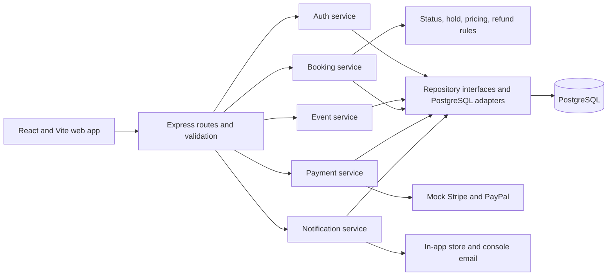

# Architecture

## Request path and layers

`server.ts` loads environment configuration, creates the PostgreSQL pool, and connects the repositories, services, and Express app. `app.ts` validates requests with Zod, checks bearer tokens and roles, routes calls to services, and returns consistent errors. Public registration creates customers; organizer accounts are provisioned from server environment variables. `db:migrate` applies each SQL migration once and records it in `schema_migrations`.

The browser supports discovery, event details, seat selection, mock checkout, booking history, notifications, and an organizer studio. Its current UI is concentrated in `apps/web/src/App.tsx`; splitting that file into smaller components is a maintainability improvement, not a separate runtime layer.

## Design patterns and why they fit

| Pattern | Where | Reason |
| --- | --- | --- |
| State machine | `domain/booking.ts` | Centralizes allowed booking transitions so invalid lifecycle changes can be rejected. |
| Strategy | `domain/pricing.ts` | Lets the organizer select base or early-bird pricing without adding branches to seat-hold logic. |
| Repository | Auth and event service interfaces; PostgreSQL adapters | Keeps application decisions separate from SQL and lets HTTP tests use in-memory repositories. |
| Provider adapter | `payment/providers.ts` | Both mock payment providers share one `PaymentProvider` interface. |
| Channel adapter | `notification/channels.ts` | Console email and in-app persistence can be extended without changing booking rules. |

## SOLID in this codebase

- **Single responsibility:** HTTP parsing and response handling live in `app.ts`; pricing, refund, and status rules live in separate domain modules; SQL access lives in repositories. The large web `App.tsx` is an acknowledged exception to improve.
- **Open/closed:** New pricing strategies can be registered in the pricing map; new payment providers and notification channels implement the existing interfaces.
- **Liskov substitution:** `AuthService` and `EventService` can use their in-memory test repositories or PostgreSQL implementations through the same contracts. Payment providers return the same charge result shape.
- **Interface segregation:** `UserRepository`, `EventRepository`, `PaymentProvider`, and `NotificationChannel` expose the operations their callers need, rather than one shared service interface.
- **Dependency inversion:** `AuthService` and `EventService` accept repository interfaces, while payment and notification services accept provider/channel interfaces. `server.ts` chooses their concrete implementations at startup. Booking, payment, and notification persistence still use concrete PostgreSQL classes and could be decoupled further.

## Booking and concurrent seat claims

`event_seats.current_booking_id` identifies the current seat claim. `PgBookingRepository.holdSeats` locks requested seat rows in stable ID order inside one PostgreSQL transaction. It rejects any active hold or confirmed seat, creates the booking and priced booking-seat rows, updates every seat claim, and commits. Another customer trying the same seat waits for the lock and then sees it unavailable. A PostgreSQL integration test exercises this race.

Holds last five minutes. A timer calls `expireHolds` every 30 seconds to mark expired bookings and free their seats. A new hold can also replace an expired seat immediately; cleanup handles the old booking after its original five-minute window. `booking_status_history` records lifecycle changes.

Payment attempts are keyed by `(booking_id, idempotency_key)`. A retry returns the saved attempt. Payment preparation checks the pending booking and its active seat claims; completion locks the booking and its seats again before confirming it. If the claim expired or changed while a mock provider call was in progress, the attempt fails and no confirmation is written. The mock providers do not transfer money. A real processor would require signed webhooks, reconciliation, and actual refunds before production use.

Public browsing exposes only published events. Seat holds require a published event whose end time is still in the future. Organizer event changes check venue and event ownership; customer booking, payment, and notification routes check customer identity.
