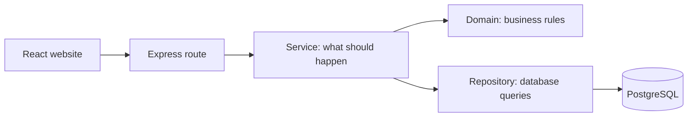

# How TicketFlow is built

**Short explanation:** “The website sends a request to the API. The API checks it, applies the booking rules, and saves the result in PostgreSQL.”

## The main path

- `apps/web/src/App.tsx` shows events, seats, checkout, bookings, and the organizer studio.
- `apps/api/src/app.ts` defines API routes, checks inputs with Zod, and checks user roles.
- Services in `apps/api/src/` handle actions such as creating an event or holding a seat.
- `apps/api/src/domain/` contains rules for booking status, hold time, pricing, and refunds.
- Repositories read and write PostgreSQL. `server.ts` connects the pieces and applies missing migrations before the API starts.

**Example:** When a customer clicks **Hold seats**, the website calls `POST /bookings/holds`. The route checks the customer token and input. The booking service asks the repository to claim the seats in one database transaction. The API returns either the hold or a “seat unavailable” error.

## Why these design patterns are used

| Pattern | Simple meaning | TicketFlow example |
| --- | --- | --- |
| State machine | A list of allowed status changes | `domain/booking.ts` prevents a cancelled booking from becoming confirmed. |
| Strategy | Choose one of several rules | `domain/pricing.ts` chooses base or early-bird pricing for an event. |
| Repository | Keep SQL separate from other code | Auth and event services can use PostgreSQL in production and simple in-memory repositories in tests. |
| Provider interface | Give payment options the same shape | Mock Stripe and mock PayPal can be switched without changing booking rules. |
| Channel interface | Send one message in different ways | In-app storage and console email both handle booking notifications. |

## SOLID, in plain words

| Principle | What to say | Example |
| --- | --- | --- |
| Single responsibility | Give each part one main job. | Routes handle HTTP; domain files handle rules; repositories handle SQL. |
| Open/closed | Add a new option without rewriting the core flow. | Add a payment provider or pricing strategy through an existing interface. |
| Liskov substitution | One implementation can replace another if both follow the same contract. | Tests swap an in-memory user or event repository for PostgreSQL. |
| Interface segregation | Keep interfaces small and focused. | `PaymentProvider` and `NotificationChannel` expose only the operations their callers need. |
| Dependency inversion | Business logic should depend on contracts, not hard-coded tools. | Services receive repository or provider interfaces; `server.ts` supplies the real implementations. |

Some booking, payment, and notification persistence still uses concrete PostgreSQL classes. The large web `App.tsx` could also be split into smaller components. These are honest areas to improve.

## How double booking is stopped

1. A seat's current claim is stored in `event_seats.current_booking_id`.
2. `PgBookingRepository.holdSeats` starts a PostgreSQL transaction and locks the selected seat rows in a consistent order.
3. It checks whether a hold or confirmed booking already owns each seat. If so, it rejects the request.
4. Otherwise, it saves the booking, seat prices, and claims together, then commits. A competing request waits for the lock and sees the updated claim.

Holds last five minutes. Cleanup runs every 30 seconds to mark old holds as expired and release their seats. A new customer can also claim a seat immediately after its hold time has passed. `booking_status_history` records status changes. A PostgreSQL integration test sends two requests for the same seat and checks that only one succeeds.

Payment requests have an **idempotency key**: repeating the same request returns the saved attempt. Before a mock payment confirms a booking, the API checks that the booking still owns its seats. The mock providers do not move money. A real payment service would need verified webhooks and payment reconciliation.

Public browsing shows published events only. Organizer routes check event and venue ownership. Customer routes check the booking owner.
